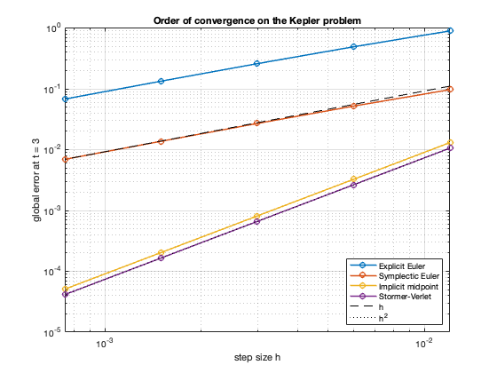
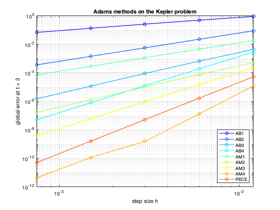
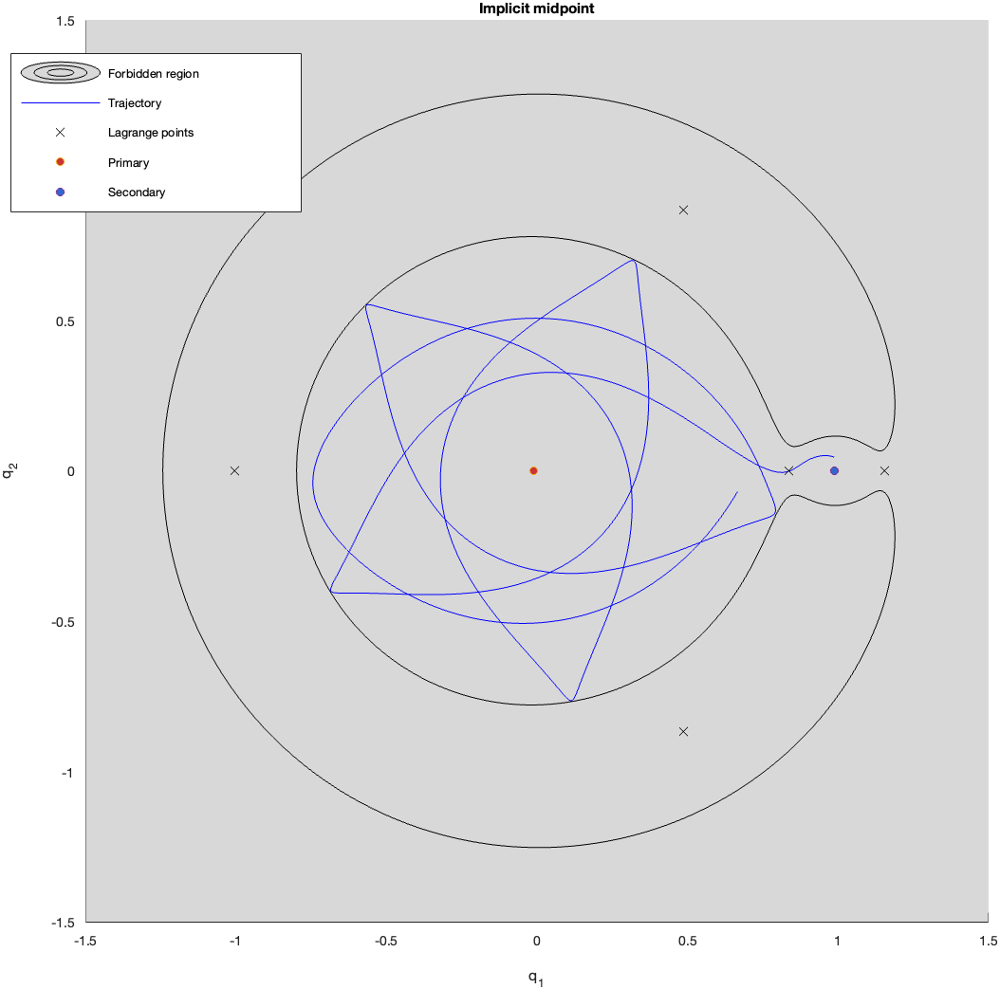
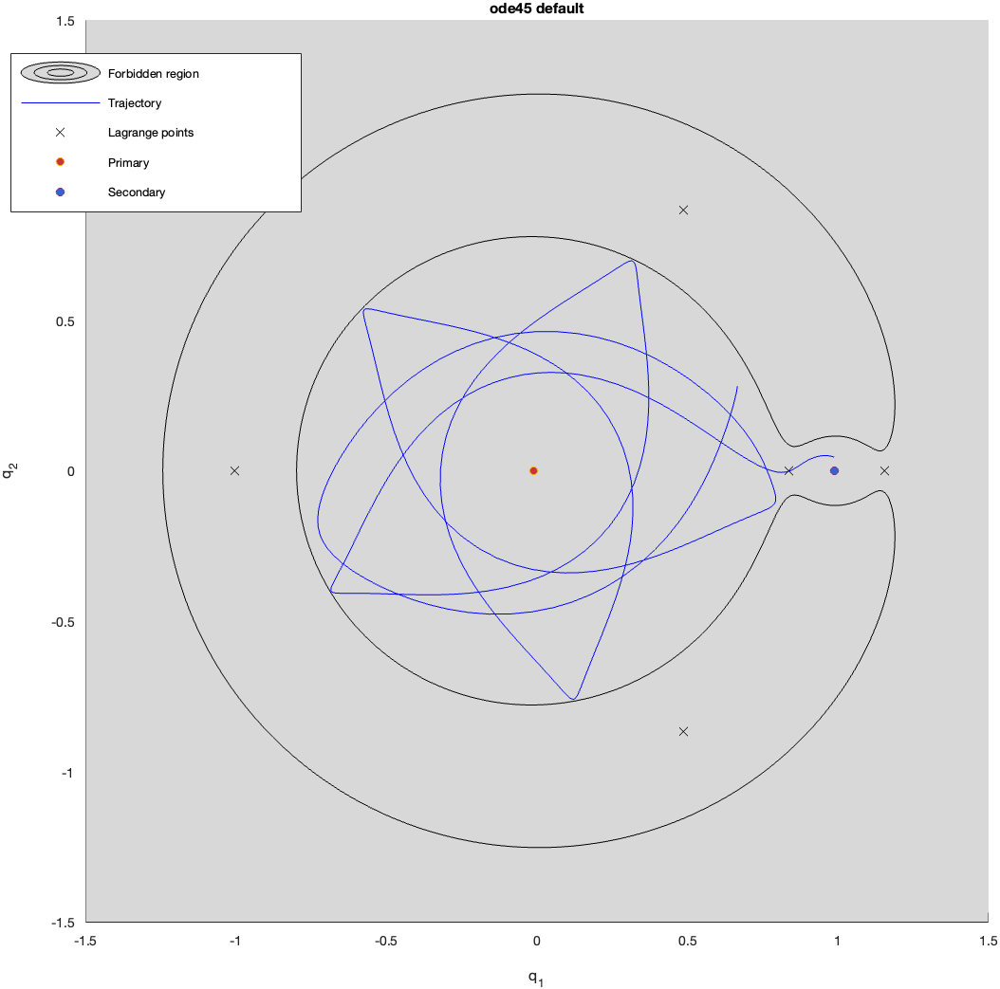
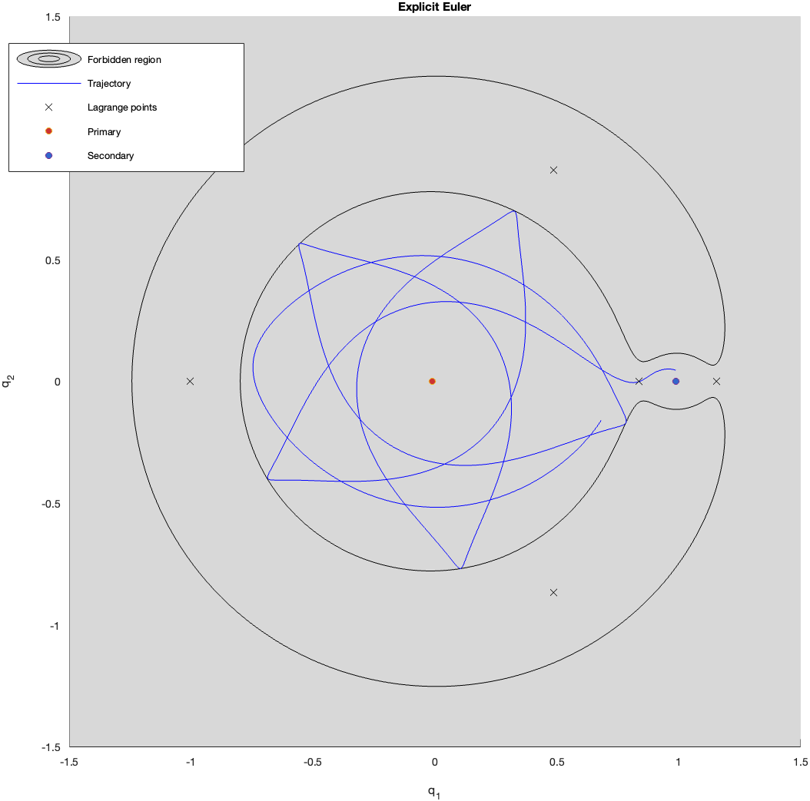
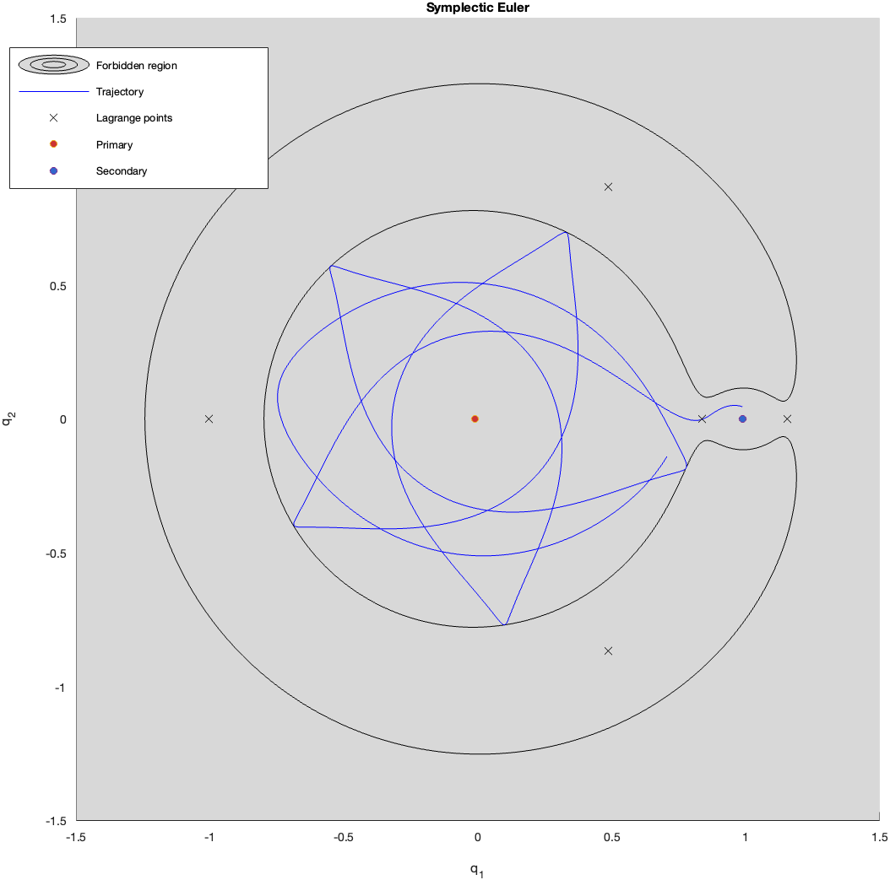
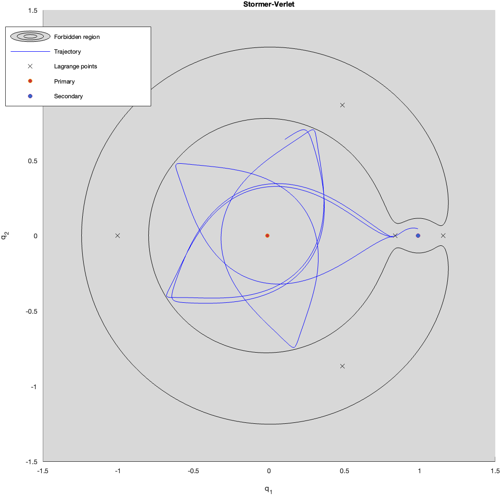
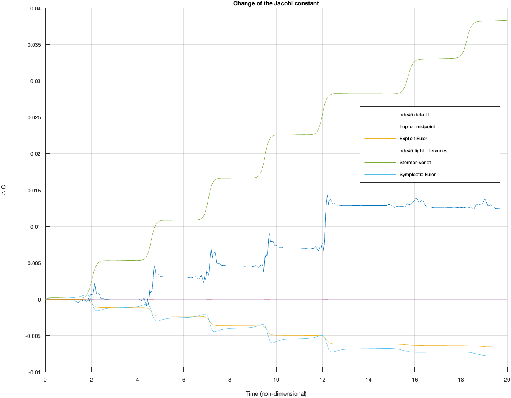

# Numerical methods in MATLAB

MATLAB implementations from my university work: integrators for Hamiltonian
systems (from my M.Sc. thesis in Mathematics) and Adams multistep methods
(Scientific Computing course). Optimisation and least squares will be added. The
Python versions with automated tests are in
[kepler-python](https://github.com/luigivarriale9/kepler-python).

## symplectic_integrators

Four one-step methods applied to the Kepler problem (eccentricity 0.7):

| File | Method | Order |
|---|---|---|
| `Euler_Explicit.m` | explicit Euler | 1 |
| `Symplectic_euler.m` | symplectic Euler | 1 |
| `Midpoint_Implicit.m` | implicit midpoint (`fsolve`) | 2 |
| `Stormer_Verlet.m` | Stormer-Verlet | 2 |

`kepler_convergence.m` computes the global error at t = 3 against the exact solution
(`kepler_position.m`, Kepler's equation solved with Newton) and prints the observed order:

```
Explicit Euler     0.93 (expected 1)
Symplectic Euler   0.95 (expected 1)
Implicit midpoint  2.00 (expected 2)
Stormer-Verlet     2.00 (expected 2)
```

   

Requires the Optimization Toolbox for `fsolve`. The script ends with an `assert`
on each order, so it also works as a check.

## adams_multistep

Adams–Bashforth `AdamsB1`–`AdamsB4` (orders 1–4), Adams–Moulton
`AdamsMoulton1`–`AdamsMoulton4` (orders 2–5, implicit equation solved by fixed-point
iteration) and the predictor–corrector `AdamsPECE` (AB4 predictor, AM4 corrector,
order 5), from the Scientific Computing course, with a few corrections.

`kepler_multistep_convergence.m` measures the observed orders on the Kepler problem
(position error at t = 3 against the exact solution, n = 250 … 4000, the same as
for the symplectic integrators):

| Method | AB1 | AB2 | AB3 | AB4 | AM1 | AM2 | AM3 | AM4 | PECE |
|---|---|---|---|---|---|---|---|---|---|
| Observed order | 0.93 | 1.99 | 2.88 | 3.95 | 2.00 | 2.91 | 3.97 | 5.30 | 5.00 |



The errors agree with the Python implementation in
[kepler-python](https://github.com/luigivarriale9/kepler-python): 41 of the 45 values
(9 methods × 5 step counts) match to four significant digits; the other four are at the
finest steps, and AM4 at n = 4000 differs by about 3%, where the error (4e-12) is close
to the accuracy of the starting values (`ode45` here, DOP853 in Python).

Tested in MATLAB R2024b and GNU Octave 8.4.

## Circular restricted three-body problem (CR3BP)

`three_body_problem.m` integrates the motion of a massless test body in the
rotating frame of two primaries (mass ratio μ) with several numerical methods,
and compares how well each one preserves the Jacobi constant.

### Run

```matlab
three_body_problem
```

The script asks two questions in the Command Window:

1. **Jacobi constant C.** Press Enter to use the value of the initial condition
   (C = 3.1624 for the default test case), or type another value. In that case the
   initial velocity is rescaled (same direction, new magnitude) so that the
   trajectory has exactly that energy level. C cannot exceed the value reached
   with zero velocity at the initial point (3.4856 for the default case).
2. **Methods.** Type a vector such as `[2 5 6]`, or press Enter to run all of them:

| # | Method |
|---|---|
| 1 | `ode45`, default tolerances |
| 2 | Implicit midpoint rule |
| 3 | Explicit Euler |
| 4 | `ode45`, tolerances 1e-12 |
| 5 | Störmer–Verlet |
| 6 | Symplectic Euler |

The figures are also saved in `figures/` (requires MATLAB R2020a or later).

### Model

State [x y z vx vy vz] in the rotating frame, non-dimensional units, primary at
(−μ, 0), secondary at (1−μ, 0):

    x'' = 2y' + x − (1−μ)(x+μ)/d1³ − μ(x−1+μ)/d2³
    y'' = −2x' + y − (1−μ) y/d1³ − μ y/d2³
    z'' = −(1−μ) z/d1³ − μ z/d2³

The Jacobi constant is

    C = x² + y² + 2(1−μ)/d1 + 2μ/d2 − |v|²

and it is conserved by the exact flow. The motion is only allowed where
C(x, y, 0) ≥ C. `jacobi_drift.m` computes the change of C along a trajectory.

### Output

- **Figures 1–6** (one per selected method): trajectory in the x–y plane, forbidden
  region (C(x,y,0) < C), the five Lagrange points, and the two primaries.
- **Figure 7**: change of the Jacobi constant over time for the selected methods.

The Lagrange points L1–L3 are computed as roots of ∂Ω/∂x = 0 on the x axis
(`fzero`); L4 and L5 are at (½ − μ, ±√3/2).

The energy level controls the shape of the forbidden region. With μ = 0.01215 the
gaps around L1, L2, L3 open at about C ≈ 3.188, 3.172, 3.012, and L4/L5 are
reached at C ≈ 2.988.

### Results (default test case, T = 20)

Maximum of |ΔC| over the integration interval:

| Method | Steps | max \|ΔC\| |
|---|---|---|
| `ode45`, tight tolerances | adaptive | 1.1·10⁻¹¹ |
| Implicit midpoint | 15394 | 1.7·10⁻⁵ |
| Explicit Euler | 700000 | 6.6·10⁻³ |
| Symplectic Euler | 120000 | 7.8·10⁻³ |
| `ode45`, default | adaptive | 1.4·10⁻² |
| Störmer–Verlet (classical) | 15394 | 3.8·10⁻² |

The methods use different numbers of steps, so these values are not a comparison
at equal cost. The Störmer–Verlet result is explained in the next section.

### Figures

Trajectories for the default test case (C = 3.1624, T = 20):

| `ode45`, tight tolerances | Implicit midpoint |
|---|---|
|  |  |

| `ode45`, default | Explicit Euler |
|---|---|
|  |  |

| Symplectic Euler | Störmer–Verlet (classical, first order here) |
|---|---|
|  |  |

Change of the Jacobi constant for all methods:



### Requirements

- MATLAB R2016b or later (local functions in scripts); R2020a or later to save
  the figures with `exportgraphics`.
- Optimization Toolbox (`fsolve`) for the implicit midpoint rule.
- Files: `three_body_problem.m`, `jacobi_drift.m`, `Midpoint_Implicit.m`,
  `Euler_Explicit.m`, `Stormer_Verlet.m`, `Symplectic_euler.m`.

## Störmer–Verlet in the rotating frame: known limitation and planned work

`Stormer_Verlet.m` implements the classical Störmer–Verlet scheme for separable
systems, q' = fq(p), p' = fp(q). It is exact in structure for the Kepler problem,
where `fp` does not depend on `p`.

**Correction.** The `flag = 1` branch originally used the opposite sign in the
half steps and therefore integrated the time-reversed flow. This has been fixed:
both branches now integrate forward and give the same result.

**Limitation for the CR3BP.** In the rotating frame, the Coriolis term makes the
acceleration depend on the velocity, so the system is not separable. Applying the
classical scheme with p taken as the velocity (as `three_body_problem.m` does)
gives a scheme that is no longer symmetric and only first-order accurate. In the
test case of `three_body_problem.m` (n = 15394 steps, T = 20) the Jacobi constant
drifts by up to about 0.038. At the same number of steps (15394), the implicit
midpoint rule keeps the Jacobi constant within about 1.7·10⁻⁵.

**Planned work.** Add a dedicated version for this problem, written in canonical
variables p = v + (−y, x, 0), with

    H(q,p) = 1/2 |p|^2 + y p_x − x p_y − (1−μ)/d1 − μ/d2

and the generalized (implicit) Störmer–Verlet method

    p_{n+1/2} = p_n − (h/2) H_q(p_{n+1/2}, q_n)
    q_{n+1}   = q_n + (h/2) [H_p(p_{n+1/2}, q_n) + H_p(p_{n+1/2}, q_{n+1})]
    p_{n+1}   = p_{n+1/2} − (h/2) H_q(p_{n+1/2}, q_{n+1})

For this Hamiltonian H_q is linear in p and H_p is linear in q, so each implicit
stage reduces to a 3×3 linear system and no nonlinear solver is required. The
method is symmetric and second-order, and it should be tested for:

- convergence order (error versus step size against a reference solution);
- Jacobi-constant drift against the other integrators;
- time reversibility (integrate forward, then backward, and recover y0).